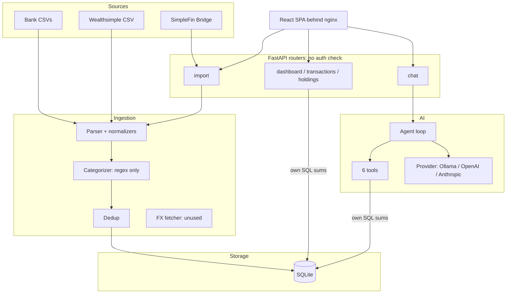

# ClawFin Review: Vision, Architecture and What Next

_Reviewed 2026-11-15 against `main` at `128b599`._

## Summary

ClawFin is a well-shaped prototype with a clear idea, but it is not yet safe or accurate enough to hold real finances. The ingestion pipeline and the agent's tool design are the strong parts. The login does not protect the API, and the headline numbers (net worth, income, expenses) are wrong for most real data.

The review covers the 11 commits on `main`: about 2,400 lines of Python, 1,300 lines of React, and six planning docs. The 10 backend tests pass. The frontend code was read but the UI was not run.

Three things matter most:

1. **The API is open.** `/api/auth/login` issues a token, but no route checks it. Anyone who can reach port 8000 can read every transaction and call the AI.
2. **The numbers are not trustworthy yet.** Transfers count as spending, currencies are added together without conversion, and net worth only knows about SimpleFin accounts.
3. **The README promises more than the code does.** AI categorization, FX conversion, Alembic migrations and net worth history are written or modelled but never wired in.

The recommendation is to stop adding features, spend one phase making the ledger correct and private, then build the Canadian-specific features that make the app worth choosing.

## Vision

ClawFin is a self-hosted ledger of one Canadian household's money that an AI can answer questions about truthfully. You run it on your own machine, feed it bank and Wealthsimple data, and ask it things a spreadsheet would take an evening to answer.

This is a proposed sharpening of `docs/clawfin-plan.md`, which is right in spirit but lists too many directions at once. Five principles decide what goes in:

- **The ledger is the product.** Every chart and every AI answer is only as good as the transactions, accounts and balances underneath. Correctness comes before features.
- **Canadian by design.** TFSA, RRSP and FHSA room, adjusted cost base, and CAD/USD handling are the reasons to choose this over a generic tracker.
- **Local and private.** One SQLite file, one password, no cloud dependency. A local model through Ollama is a first-class option.
- **Read and simulate only.** The agent never moves money. It reads the ledger through named tools and never gets raw database access.
- **An appliance.** `docker compose up`, import, ask. No setup step should need editing a file and restarting.

What ClawFin should not become, at least for now:

- A multi-user or hosted service. The README lists multi-user for Phase 2; it adds accounts, permissions and data separation to an app whose single-user numbers are not right yet.
- A cloud-synced app. The plan mentions Supabase; it contradicts the privacy principle and solves no current problem.
- A full budgeting suite or a PDF report generator. The agent answering questions is the report.
- A tax filing tool. Tracking room and cost base is in scope; producing T-slips is not.

## What works

The foundations are sound and small enough to change quickly.

| Area | What is good | Where |
| --- | --- | --- |
| CSV ingestion | Header-signature detection picks the right parser for TD, RBC, Scotiabank, BMO and CIBC, one small normalizer per bank | `backend/ingestion/parser.py`, `normalizers/` |
| Deduplication | A hash with a per-day sequence counter keeps two identical same-day purchases and still skips a re-imported file | `backend/ingestion/dedup.py` |
| Agent tools | Six narrow, typed tools instead of free SQL. The model cannot read or write anything the tools do not expose | `backend/ai/tools.py` |
| Provider layer | One wire format for Ollama, OpenAI and Anthropic through plain `httpx`, so the agent code does not care which model runs | `backend/ai/provider.py` |
| Rule cache | Merchant-to-category results are stored as rules, so a merchant is classified once | `backend/ingestion/categorizer.py` |
| Data model | Account, Transaction, Holding, Snapshot, CategoryRule and FxRate cover what the vision needs | `backend/db/models.py` |
| Deployment | Two containers, a named volume for the database, an optional Ollama profile, a health check | `docker-compose.yml` |
| Dependencies | Five frontend packages and nine backend ones. Little to maintain | `package.json`, `requirements.txt` |
| Tests | 10 tests cover the parser, dedup and the Wealthsimple parser, and all pass | `backend/tests/` |

The product shape is also right: a dashboard, a transaction list, holdings, an import screen and a chat panel on a shortcut is the correct small set of screens.

## What doesn't work

### Security and privacy

| Problem | Detail | Where |
| --- | --- | --- |
| No route checks the login token | `login` signs a JWT, but nothing ever decodes one. Every router depends only on `get_db`. The frontend sends the header; the backend ignores it | `backend/routers/auth.py`, `backend/main.py` |
| The backend port is published | Compose maps `8000:8000`, so the unprotected API is reachable from the network, bypassing nginx | `docker-compose.yml` |
| The signing key has a known default | `SECRET_KEY` falls back to `clawfin-dev-secret-change-me`. Once tokens are checked, a forgotten env var means forgeable tokens | `backend/config.py` |
| The SimpleFin access URL is returned to the browser | Setup exchanges the one-time token, then hands the permanent credential back in the response and does not store it. The token is spent, and the user has to copy the URL into `.env` and restart | `backend/routers/import_data.py` |

### Wrong numbers

| Problem | Detail | Where |
| --- | --- | --- |
| Transfers count as income and spending | Income is every positive amount, expenses every negative one. A credit card payment is an expense on the chequing side and income on the card side. The `Transfer` category exists but is not excluded | `backend/routers/dashboard.py`, `backend/ai/tools.py` |
| Payroll is categorized as a transfer | `payroll` appears in the Transfer pattern, which is tested before Income | `backend/ingestion/categorizer.py` |
| Category patterns have no word boundaries | `rent` matches "Parent", `gap` matches "Singapore", `event` matches "Prevention" | `backend/ingestion/categorizer.py` |
| Currencies are added together | The Bank of Canada FX module is never called. Dashboard, net worth and holdings totals sum amounts whatever their currency | `backend/ingestion/fx.py` (unused) |
| Net worth ignores CSV users | Only SimpleFin sync creates accounts. A user who imports CSVs has no accounts, so cash is zero | `backend/routers/import_data.py` |
| Every SimpleFin account is typed as chequing | Credit cards and savings are stored as `CHEQUING` with no screen to change it | `backend/routers/import_data.py` |
| The same transaction imports twice across sources | The dedup hash includes the account and the raw merchant text. A CSV import and a SimpleFin sync of the same purchase produce different hashes | `backend/ingestion/dedup.py` |
| SimpleFin dates use the server's time zone | `datetime.fromtimestamp` without a zone can shift a late-evening purchase to the next day | `backend/ingestion/simplefin.py` |

### Promised but not wired

| Claim in the README | Reality |
| --- | --- |
| Batch LLM categorization | `categorize_transactions` accepts an `ai_categorize_fn`, and no caller passes one. Categorization is regex only |
| Multi-currency via the Bank of Canada | The fetcher exists and nothing calls it |
| Alembic migrations | Alembic is in `requirements.txt`; there is no migrations directory. Tables are made with `create_all`, so any model change needs a manual fix or a wiped database |
| Net worth over time | The `Snapshot` table is never written |
| Wealthsimple account tracking | Account name and type are parsed from the export and then dropped. Each holdings import deletes the previous one, so there is no history and no TFSA/RRSP split |
| Contribution room | Three manually typed numbers in `app_config`. Nothing is tracked against them |

### Agent

- The streaming path runs one round of tool calls; the non-streaming path runs up to five. A question that needs two lookups works in one endpoint and fails in the one the UI uses (`backend/ai/agent.py`).
- A reply chunk that contains a newline breaks the SSE framing. The client splits on newlines and drops any line without a `data:` prefix, so multi-line answers lose text (`backend/routers/chat.py`, `frontend/src/api/client.js`).
- Tool arguments are parsed with a bare `json.loads`. Local models often emit invalid JSON, and that becomes a 500.
- Tools take a `days` lookback only. "What did I spend last March" cannot be asked precisely. There is no tool for income, contribution room or net worth history.
- Conversation history comes from the client as raw dicts with no validation, including the `system` role.

### Engineering hygiene

- Money is stored as `Float`. Sums drift by cents; use integer cents or `Numeric`.
- No foreign keys: `account_id` is a bare integer on transactions and holdings.
- Errors return HTTP 200 with an `error` field, and `update_transaction` returns a tuple that FastAPI serializes as a JSON array instead of a 404.
- Dashboard and agent tools each reimplement spending and net worth sums. They will drift.
- Tests cover three ingestion modules. Nothing covers the routers, the categorizer, the agent or the frontend, and there is no CI. `vitest` is installed with no tests.
- `docs/` holds six overlapping plans, and `evaluation_report.md` describes features as done that are not.
- Small leftovers: `passlib` is unused, `on_event` is deprecated, `Snapshot` and `Category` are imported in `tools.py` and unused.

## Architecture

### Current design

The layering is right: sources, ingestion, one store, an API, an agent, a thin UI. Three structural problems sit inside it:

1. **There is no ledger layer.** Routers and agent tools each query the tables and do their own arithmetic. Rules such as "transfers are not spending" and "convert to CAD" have no single place to live, which is why they are missing everywhere.
2. **Accounts are optional.** Transactions and holdings can exist with no account. Net worth, registered-account tracking and cross-source dedup all need every row to belong to an account with a type and a currency.
3. **Configuration is environment only.** AI provider and SimpleFin credentials need a file edit and a restart, which breaks the appliance promise.

### Target design

Keep the stack. FastAPI, SQLite, React and direct `httpx` calls are all the right size. Change four things:

1. **Add a ledger service** (`backend/ledger/`) with functions such as `spending(range, group_by)`, `income(range)`, `net_worth(as_of)` and `holdings(account)`. It owns transfer exclusion, FX conversion and sign conventions. Dashboard routes and agent tools both call it and nothing else touches the tables for reads.
2. **Make accounts mandatory.** Every import targets an account: chosen at upload for CSVs, created from the export's account columns for Wealthsimple, mapped from SimpleFin. Add foreign keys. Dedup on account plus date plus amount, with the provider's transaction id when there is one.
3. **Put one auth dependency on the whole API.** A single `Depends(require_auth)` on every router except login and health, refuse to start with the default secret key, and stop publishing port 8000.
4. **Move runtime settings into the database.** Store AI provider settings and the SimpleFin access URL in `app_config`, encrypted with a key derived from the secret, editable from the Settings screen.

Alongside those: adopt Alembic before the next schema change, store money as integer cents, write a `Snapshot` row on every import and sync, and merge the two agent loops into one streaming loop that emits JSON-encoded SSE events.

## What next

### Phase 0: make it safe (days)

- [ ] Enforce the token on every route except login and health
- [ ] Fail startup when a password is set and the secret key is the default
- [ ] Remove the `8000:8000` port mapping from compose
- [ ] Store the SimpleFin access URL server-side; never return it
- [ ] Correct the README so it describes what the code does
- [ ] Add CI that runs pytest and a frontend build

### Phase 1: make the numbers right (1 to 2 weeks)

- [ ] Add the ledger service and move dashboard and tools onto it
- [ ] Require an account on every import; add an accounts screen with editable type
- [ ] Exclude transfers from income and spending; fix the payroll rule and add word boundaries
- [ ] Convert to CAD with the existing FX module at the transaction date
- [ ] Add Alembic, foreign keys and integer cents
- [ ] Write a net worth snapshot on every import and sync
- [ ] Keep Wealthsimple account type and holdings history
- [ ] Tests for the ledger service with a fixture ledger whose answers are known

### Phase 2: make the agent good (1 to 2 weeks)

- [ ] One streaming tool loop with JSON SSE events and guarded argument parsing
- [ ] Date-range parameters on tools; add income, net worth history and contribution room tools
- [ ] Wire in LLM categorization for merchants the rules miss, with a rules screen to correct it
- [ ] Show which tools the agent called under each answer, so numbers can be checked
- [ ] A small evaluation set: 20 questions against the fixture ledger with expected figures

### Phase 3: the Canadian edge

- [ ] TFSA, RRSP and FHSA room tracked from contributions seen in activity imports
- [ ] Adjusted cost base per security in non-registered accounts
- [ ] Recurring transaction and subscription detection
- [ ] Net worth chart by account type, with goals
- [ ] Scheduled SimpleFin sync

Phase 0 and Phase 1 are not optional. Phase 3 is the reason the app exists, but it produces wrong answers if built on the current ledger.

## Open decisions

- **Is this for you alone, or for others to self-host?** If others, Phase 0 needs password hashing, rate limiting on login and a first-run setup screen as well.
- **Is the default model local or hosted?** Small local models are weak at tool calling. If Ollama stays the default, the agent needs fewer, simpler tools and the evaluation set should run against it.
- **Is SimpleFin a core source or an optional extra?** If core, cross-source dedup against CSV history needs real design. If optional, tell users to pick one source per account and skip that work.
- **Should the six planning docs be collapsed?** Suggested: keep `clawfin-plan.md` as the vision, replace the three implementation plans and the evaluation report with this review, and track the roadmap as issues.
